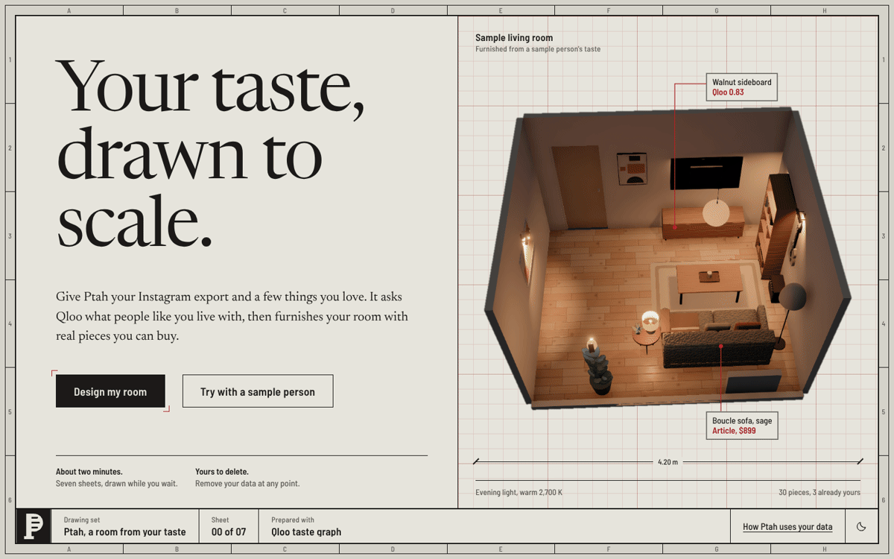

# Ptah

**Your taste, drawn to scale.** Ptah reads what you love, asks [Qloo](https://www.qloo.com/) what people with that taste actually live with, and turns it into a furnished, lit 3D room filled with real pieces you can buy.

Built for the [Qloo Agentic Hackathon](https://qloo.devpost.com/).

**[Try the live demo](https://rvkarmani.github.io/ptah/)** · [How it uses Qloo](#how-ptah-uses-qloo) · [Run it yourself](#run-it-yourself)



## What it does

1. **Reads your taste.** Upload your Instagram data export (saved posts, likes, saved music) and/or type a few things you love: an artist, a film, a restaurant, a city.
2. **Grounds it in Qloo.** An agent resolves what it finds into real Qloo entities, then asks Qloo's taste graph what that taste implies for a home.
3. **Designs the room.** A design brief becomes a spec: palette, materials, lighting mood and a list of pieces, each with a "why this fits you" chain back to your taste.
4. **Shops for real pieces.** It searches Google Shopping, keeps only listings that fit the palette, materials and scale, and links to the actual store.
5. **Lays out and lights it.** A constraint solver places everything (door swings, windows, walkways, wall and ceiling mounts), then plans ambient, task and accent lighting for day, evening, reading and night.
6. **Shows it in 3D.** Orbit the room, click any piece for its price, store link and alternatives, switch lighting scenes, and change the floor or wall colour.

You watch it happen live: every Qloo lookup, AI step and shopping search appears on the progress screen as it runs.

## How Ptah uses Qloo

Qloo is the part that makes the room *yours* instead of generically "nice". Ptah doesn't map "likes jazz" to "buy a record player". It uses Qloo's cross-domain taste graph to infer what your music, film and food taste says about the spaces you'd feel at home in.

| Step | Qloo API | What it gives the room |
|---|---|---|
| Resolve your taste | `/search` | Turns names from your posts and favourites into real Qloo entities (with ID and provenance checks, so the AI can't invent any) |
| Decor and ambience | `/v2/insights` taste analysis on `urn:tag:decor:qloo` and `urn:tag:ambience:qloo`, scoped to places | The styles and moods of interiors that people with your taste love, which drive the palette and materials |
| Inspiration places | `/v2/insights` for places (bars, cafes, hotels, galleries) | Real venues whose interiors match your taste; their tags feed the design and its reasoning |
| Local shops | `/v2/insights` for furniture and decor stores near you | Nearby stores that match your taste, saved in the design brief |
| Home brands | `/v2/insights` with `filter.results.entities` | Ranks a catalog of home brands by affinity to your taste, steering the product search |
| Discovery | `/v2/insights` with explainability | Films, music and books you'd likely love; their tags add cross-domain signal to the design |

Every recommendation keeps its chain back to the Qloo signal it came from, so the room can explain itself.

## Live demo

**https://rvkarmani.github.io/ptah/**

The hosted demo is a static build with no server and no API keys. Choose **Try with a sample person**: it replays a recorded run and opens a room Ptah designed for a real person (their Instagram data and personal details removed). Explore it fully: orbit, switch lighting scenes, open any piece for its real store link, "why this fits" chain and alternatives, and change the floor and walls. Designing from your own data needs the full app with keys, below.

## Run it yourself

You need Python 3.11+, Node 22+ and [Deno](https://deno.com) (the taste agent runs model-written code in a Deno sandbox).

```bash
git clone https://github.com/RVKarmani/ptah.git && cd ptah
python3 -m venv .venv && source .venv/bin/activate
pip install -r requirements.txt
(cd viewer && npm ci && npm run build)
```

Create a `.env` file in the project root:

```bash
QLOO_API_KEY=...          # Qloo hackathon key
OPENROUTER_API_KEY=...    # or any provider litellm supports
PTAH_LM=openrouter/nvidia/nemotron-3-ultra-550b-a55b:free        # main model
PTAH_SUB_LM=openrouter/nvidia/nemotron-3.5-super-vl:free         # cheaper model for sub-queries
SERPAPI_KEY=...           # Google Shopping search
```

Start the app and open http://localhost:8000:

```bash
python -m server --port 8000
```

Choose **Design my room**, add your Instagram export (download it from Instagram in **JSON** format) and/or a few things you love, pick a room, and watch it build. To get the export: Instagram → Accounts Center → Your information and permissions → Download your information.

### Run the pipeline step by step (optional)

```bash
python ingest_instagram.py path/to/export.zip   # -> data/posts.jsonl, music.json, summary.json
python run_taste.py                             # taste agent (DSPy RLM + Qloo) -> data/taste_profile.json
python run_brief.py                             # Qloo design brief -> data/brief.json
python run_design.py                            # design spec, layout, lighting -> data/runs/design_<time>/
python run_scout.py --only all                  # real products for that design (SerpApi)
pytest -q tests                                 # no keys, network or LLM needed
```

Viewer development: `cd viewer && npm run dev` (http://localhost:5173, loads the bundled sample room).

## How it's built

```
Instagram export + things you love
        │
        ▼
  ingest ──► taste agent ──► Qloo brief ──► design ──► products ──► layout ──► lighting ──► 3D viewer
             (DSPy RLM +      (taste          (LLM      (SerpApi +   (constraint  (lux grid,
              Qloo tools)      analysis,       spec)     cohesion     solver)      scenes)
                               places,                   scoring)
                               brands)
```

- **Agent:** [DSPy](https://dspy.ai) `RLM`, which explores your posts with code and calls Qloo as tools. Guardrails reject any Qloo entity that wasn't actually returned by the API.
- **Backend:** FastAPI, a background job pipeline and live progress over server-sent events (`server/`, `ptah/pipeline.py`).
- **Products:** SerpApi Google Shopping, with a cohesion score (CIEDE2000 colour distance to the palette, materials, style and scale), real merchant links and alternatives (`ptah/products/`).
- **Layout and lighting:** a depth-first constraint solver inspired by Holodeck and LayoutVLM, and an approximate lighting model (`ptah/layout/`, `ptah/lighting.py`).
- **Viewer:** React, three.js and react-three-fiber, with procedural low-poly models, PBR materials and real light sources. The visual identity treats every screen as a sheet in an architect's drawing set (`viewer/`).

| Folder | What's inside |
|---|---|
| `ptah/` | Taste agent, Qloo client, brief, design, products, layout, lighting, pipeline |
| `server/` | FastAPI app: uploads, jobs, live progress, demo replay |
| `viewer/` | Web app: onboarding, progress screen, 3D room |
| `samples/` | A sample room, items and constraints |
| `tests/` | Backend tests (run offline) |
| `docs/` | [Data contracts](docs/contracts.md) and [technical notes](docs/technical-notes.md) (every CLI flag, URL parameter and API endpoint) |

## Privacy

- Your Instagram zip is deleted as soon as it is read; only the derived posts file is kept, and you can delete a job and everything in it at any time.
- API keys stay in `.env` and are never logged or sent to the browser.
- Personal data (`data/`) and cached Qloo responses (`cache/`) are git-ignored and never committed.

## License

[MIT](LICENSE)
